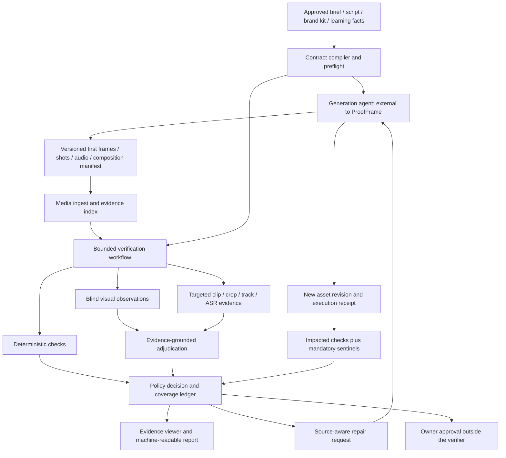

# ProofFrame V3 implementation specification

Status: build specification with a tested contract harness, NOT an implemented video-verification application. Supersedes the earlier ProofFrame starter kits and handoff prompts where they conflict.

## Product contract

ProofFrame is an external **production acceptance service** for generative media pipelines. Its job is to decide whether declared requirements have been demonstrated, identify localized contradictions, request bounded repairs, and test revised artifacts. It does not certify universal truth, artistic merit, legal compliance or readiness for children. A release-eligible result is not authorization to publish.

Primary callers are the existing Content Engine, the Tần Số 0 production workflow, and the children's educational-video workflow. Integration must also work with a browser-operated generation agent: JSON plus local asset files is a first-class interface. Do not assume Google Flow or any other generator has an accessible automation API.

## Architectural boundaries



Implement a modular Python core, FastAPI transport, one asynchronous worker, PostgreSQL, a storage abstraction and a small Next.js evidence UI. Keep media extraction CPU-compatible. Specialized local GPU models are optional remote/worker capabilities, never required for booting the service. Do not install VBench, VideoMind, a local model server or a collection of research dependencies into the base API image.

Use one provider adapter module per provider and capability, not one class per model name. The domain layer must not import provider SDKs. Prefer direct official SDKs first. A transport gateway may be shared with Content Engine, but model capability declarations and release policy stay inside ProofFrame. A generic compatible chat endpoint is not a sufficient abstraction for ASR, native video and SAM mask streams.

Recommended structure:

```text
apps/api/                 FastAPI; authentication; jobs; asset registration
apps/worker/              persistent task execution and reconciliation
apps/web/                 timeline, evidence, repair diff, run history
packages/domain/          typed contracts, policy, timeline mapping, dependencies
packages/media/           ffprobe/ffmpeg, clip/crop extraction, evidence index
packages/verifiers/       deterministic and model-assisted checkers
packages/providers/       capability registry and verified provider adapters
packages/repair/          diagnosis, action catalog, external executor protocol
packages/evaluation/      datasets, baselines, ablations, metrics
profiles/                 film, brand and educational-video policy packs
```

Reuse the current repository's compatible conventions instead of restructuring for aesthetics. Use supported, pinned dependency versions and lockfiles established at Gate 0; do not assume that a new version number guarantees compatibility. Python 3.12 is a reasonable initial runtime candidate, subject to actual dependency tests. PostgreSQL-backed jobs avoid adding a second broker initially.

## Three production checkpoints

### A. Preflight: before expensive generation

Inputs: approved intent, shot plan, references and generation specification. Check missing or contradictory constraints, timeline arithmetic, required beats, permitted characters/props, exact approved copy, and whether the chosen generator supports required controls. Return concrete source field paths, not generic creative criticism.

Compile assertions once per contract revision. Do not ask a model to re-invent requirements after each render. Explicit structured intent can be compiled deterministically; inferred assertions from prose are drafts with source spans and authority. Ambiguous creative preferences remain advisory or require one batch confirmation, not an approval request for every shot.

### B. First-frame and shot gates

Validate a first frame before turning it into an expensive clip when the generator uses first-frame conditioning. Check each shot while retaining its planned role, reference set and incoming/outgoing story state. Catch local defects without rereading the whole episode.

Do not confuse correct first/last frames with a correct action. Action checks require evidence of the relevant transition. A first-frame pass never implies a full-shot pass.

### C. Assembly and export gate

Check sequence order, required-beat coverage, dialogue/subtitle/audio alignment, declared retimes, clip duplication, technical encoding and cross-shot boundaries. Use the actual composition manifest when available. Retest critical release requirements on the assembled export, not just on source shots.

A 17-minute file created by slowing an 8-minute cut is not necessarily a valid 17-minute story. Detect declared speed changes and repeated source ranges, compare them with allowed editorial transforms, and verify required beats separately. Do not infer 'meaningful duration' from motion alone; static artistic shots may be intentional.

## Domain and authority model

Separate these records:

- `ApprovedIntent`: versioned, owner-authorized screenplay/brief/reference/claim policy.
- `Observation`: what a detector or person observed, with evidence and limitations.
- `Hypothesis`: an inferred explanation or proposed root cause; never canonical truth.
- `Decision`: a policy result based on specific assertions and evidence.
- `RepairRequest`: requested changes to production inputs or outputs, not to approved truth.
- `RepairReceipt`: what an external producer actually changed and returned.

Approved intent names logical asset slots and hash-bound canonical references. Actual generated-output revisions belong in run manifests, not in the approved contract fingerprint; replacing a rendered shot must not silently rewrite approved intent. Every artifact is immutable: asset ID, revision, SHA-256, media type, provenance and ownership. Keep source, proxy, crop, frame, audio extract and edited output as separate assets linked by transformations. Do not use a signed URL as an identity; it can expire or point somewhere else.

Expected story state and observed state are different stores. Expected state can have approved transitions: wardrobe changes, possession transfer, damage, time of day, location or knowledge acquired. Include story time separately from playback time so flashbacks and the film's future-audio premise do not look like continuity errors. Do not infer an off-screen transition as fact merely to make a failing render pass.

The first representation is JSON/Pydantic with PostgreSQL tables/JSONB and an explicit dependency-edge table. A graph database is not required. Store assertion dependencies and separate production-asset dependencies. An observation inferred from a bad shot cannot silently become the next episode's reference.

## Assertions and evaluation outcomes

Each assertion needs a stable ID, intent source, predicate, scope, severity, blocking/advisory status, expected value/event, approved exceptions, reference IDs, evidence prerequisites, coverage requirement and dependency IDs. Distinguish exact constraints, semantic equivalence, temporal transitions and editorial preferences.

Required status values:

- `PASS`: the declared evidence and coverage requirements are satisfied.
- `FAIL`: sufficient evidence contradicts a declared requirement.
- `UNCERTAIN`: relevant evidence exists but does not support a reliable conclusion.
- `NOT_CHECKED`: no evaluation occurred, including unsupported capability or exhausted budget.
- `ERROR`: an operational failure prevented evaluation.
- `NOT_APPLICABLE`: only when an approved scope rule excludes the assertion, with an explicit reason.

Execution status, check status and release policy are separate. A finished job is not a passed video. A rejected provider request is not a film defect. No findings is not a clean bill when coverage is missing.

Policy decisions are `BLOCK`, `REVIEW` or `ELIGIBLE`. Any blocking failure blocks; any unresolved blocking assertion requires review. An explicitly excluded assertion is recorded, not erased. All mandatory check IDs must remain in the report. A weighted overall score cannot overrule this policy. Publishing remains outside this service.

## Verification algorithm

1. Load the immutable contract and create the mandatory coverage ledger BEFORE candidate detection.
2. Ingest media; verify type, hash and metadata; derive evidence without losing source time mapping.
3. Run deterministic checks and gather neutral observations. Use approved production shot IDs; run shot detection as a fallback, not as ground truth.
4. For each check, select evidence appropriate to its predicate. Group compatible questions to avoid duplicate uploads, but never let batching remove critical checks.
5. Ask neutral observation questions before comparison where feasible. For example, observe the clothing color without revealing the desired color. When references are necessary, supply them neutrally without the producer's 'fixed successfully' claim.
6. Compare observations with approved intent in deterministic code for closed, measurable attributes. Use a qualified adjudicator for relational or narrative interpretations.
7. Refine insufficient evidence: denser temporal samples, an actual clip, higher-resolution crop, a context frame, object tracks or audio. Choose the new evidence that can resolve the ambiguity.
8. Seek plausible counter-evidence, including an approved change, occlusion, off-screen state, a cut or a subtitle/voiceover distinction. Do not equate a second agreeing response with independent proof.
9. Emit validated evidence IDs and source intervals. Server-side code validates that assets exist, hashes match and intervals are in bounds. This validates provenance, not the truth of the model's interpretation.
10. Stop on sufficient evidence, escalation limit, budget limit or irreducible ambiguity. Persist unresolved checks explicitly.

A cheap candidate detector must NEVER be the only way a critical assertion reaches the judge. Otherwise a cheap-model false negative prevents the expensive model from seeing the problem. Mandatory requirements get planned evidence regardless of candidate discovery; cheaper signals prioritize optional anomaly checks.

Maintain an unconditional sample of apparently passed checks for audit, configured initially at 10% as an operational choice, not a statistically justified guarantee. High-risk assertions remain subject to stricter qualified routes. Increase auditing when models, prompts, reference styles or domains change.

## Media and time correctness

Use source PTS/timebase and exact rational transforms internally. Presentation microseconds are convenient outputs but not a replacement for decode timestamps. Keep source-local, clip-local, proxy and final-timeline coordinates distinct.

The first adapter supports cuts, trims and constant positive speed only. Ramps, reverse, nesting, transitions and nonlinear time effects must either have a tested mapping or be marked unsupported. OTIO is an optional interchange adapter, not a promise that every NLE effect is understood. [S21]

Return actual extracted frame IDs instead of trusting model-generated timestamps. Coarse suggested times trigger local extraction and confirmation. Preserve a context frame beside crops so an object cannot be judged in an isolated, misleading region.

For absence claims, require visibility and temporal coverage appropriate to the claim. A mask missing from sampled frames is not proof of an object disappearing. For events, check order and transition evidence, not just opening/closing appearance. Sampled results must be labeled as such; do not report exhaustive verification from sparse frames.

## Provider capabilities and Meta implementation

Capabilities include structured text reasoning, image observation, native video observation, temporal localization, segmentation/tracking, speech transcription, forced alignment, image editing, and video editing. Availability is distinct from qualification: an API can accept a video but still perform poorly for a specific check.

A capability record includes provider/model ID, actual revision when exposed, endpoint, input types and limits, media representation, result schema, timeout/polling behavior, retention policy, supported options, cost accounting and last smoke test. Router decisions are versioned and logged.

Two configurations:

- `meta_hackathon`: critical demonstrated reasoning uses real Meta models. Unsupported behavior is visible; non-Meta fallback cannot silently take over a claimed Meta demonstration.
- `production_best_qualified`: each check routes to an empirically qualified provider. Opus can remain a targeted adjudicator; other models must earn comparable responsibilities through evaluation.

Do not assume High/Extra UI modes map to a specific API setting. Discover the actual API identifiers/configuration from authorized environment configuration. Never use a consumer UI subscription as if it were an API credential.

Meta smoke tests must exercise real native video, structured output, the segmentation output parser and Vietnamese ASR with short owned fixtures. Official docs identify video input and an audio caveat for Spark 1.3. SAM returns special-token box/mask records, not ordinary JSON findings. Use an official parser if suitable; a tiny local Node parser command is preferable to inventing a decoder when Python support is absent. [S23-S25]

Muse Voice documentation explicitly describes turn-level, not word-level, timestamps. Its processing progress is NOT a word timestamp. Verify the actual turn fields in live probes; for word timing, use an independently validated alignment tool or retain only truthful segment timing. ASR completion does not prove lip sync, and diarization labels do not establish named-character identity across sessions. [S25]

SDK clients must not apply one universal temperature, reasoning or output-budget setting to every model. Parse failures, truncated outputs, refusals and unsupported options are explicit execution outcomes. Never normalize malformed results into PASS.

## Cost and quality control

Do not optimize cost per API call alone. Record the entire unit of work:

`total_cost = ingest + observations + judge_calls + escalation + repairs + reverification + review_time_cost_if_declared`

Report separately the money actually billed, estimated amounts, unpriced calls, provider credits and reviewer time. Unknown usage is unknown, not zero. Credits are not equivalent to a hard spending cap.

Use an atomic budget ledger: reserve a conservative upper amount before a paid call, settle actual usage when known, and retain reservations for uncertain timeouts until reconciliation. Concurrency must not spend the same remaining budget twice. If the provider exposes no adequate cost bound, restrict the request or require a configured conservative reservation.

Workers execute at least once, not magically exactly once. Idempotency covers local state and providers that support it; ambiguous external requests need reconciliation before retry. A timed-out generation may still complete and incur cost. Never claim that canceling a local coroutine cancels provider billing.

Persist attempts, checkpoints, leases and heartbeats. Use atomic job claims, lease expiry and a retry classification. Retry transient failures with jitter and bounds; do not retry invalid requests, missing credentials or safety refusals indefinitely.

## Repair protocol

Every repair request references the verification run, contract hash, input asset hashes and specific findings. It includes the source stage, target scope, required changes, constraints to preserve, supported executor capability, estimated cost basis, approval policy, retest set and stop conditions.

Action catalog:

- `FIX_COMPOSITE`: replace approved logo/text/overlay without regenerating footage.
- `FIX_SUBTITLES`: correct text/timing using approved transcript and alignment.
- `REMIX_AUDIO`: fix levels or track placement; preserve approved speech content.
- `REGENERATE_AUDIO`: regenerate the explicitly failed utterance only.
- `PATCH_GENERATION_SPEC`: change allowed generation fields using a scoped patch.
- `REGENERATE_SHOT`: generate a new immutable shot version.
- `EDIT_VIDEO_REGION`: only when the chosen executor supports it and preservation is verified.
- `REASSEMBLE`: trim/order/transition changes with a validated timeline mapping.
- `HUMAN_REVIEW`: unresolved evidence or incompatible constraints.

Do not offer `EDIT_FRAME` as a claimed repair for a video unless the change is propagated and temporally verified. An edited reference image is only a new generation input, not a repaired movie.

Do not expose arbitrary shell commands, file writes or tool names in an LLM-generated repair. Map typed actions to allowlisted executors. Repairs cannot change the approved contract, drop failing tests, replace canonical references, reduce the target duration or hide failures by changing labels.

Executor preconditions check the expected input hashes. A stale result is rejected. The receipt lists new assets, changed source fields, generator settings, parent versions, costs and failure states. Preservation is a request and test target, not a guarantee a generative model will comply.

Regression reruns all checks touching changed inputs/references, their transitive dependents, affected boundaries and global mandatory sentinels. Neighbor-only checks are insufficient for callbacks, recurring props or a long-range story event. Reuse unchanged evidence only when its complete cache key still matches.

No automatic 'fixed' claim if the failed region is now unobservable or the check was skipped. Distinguish fixed, still failing, regressed, uncertain and stale/not-comparable. Compare against the same approved requirement version; changing intent requires a separate approved run.

Initial stop rules: at most two attempts for one repair target, no unbounded agent loop, stop on the same unresolved failure, new critical regression or exhausted budget. Prefer a targeted local repair when it meets the requirement; do not change the creative goal merely to fit a cheap provider.

## Profile: Content Engine

Preserve Organization -> Brand -> Campaign -> Content/AssetVersion identifiers. Bind each run to the specific Brand Kit and approved product/copy references. The producer and verifier may share provider infrastructure through a gateway, but use separate permission scopes and immutable contract revisions; the producer cannot rewrite the verifier's approved intent or decisions.

Initial checks: exact original logo asset at the compositing source; approved slogan/text; required disclaimer presence and supplied wording; text clipping/safe-zone checks from actual layout metadata; caption/voiceover/visual alignment; requested aspect ratio and duration; wrong asset version; unauthorized changes to elements the owner asked to preserve.

For text/logo fidelity, prefer the compositor's exact asset/text inputs and final rendered-region inspection. VLM observation is preferable to adding OCR indiscriminately; introduce specialized OCR only when necessary, validate it on Vietnamese, and do not treat a questionable OCR string as legal/product truth.

Approved Product Truth is the source for factual-claim matching. Unknown or unsupported claims require review; this system is not a legal or insurance-compliance authority. Do not browse arbitrary web content at runtime and silently promote it into the client's approved claims.

## Profile: Tần Số 0 / film

Use a versioned series bible and actual approved shot plan. Verify wardrobe/props as visible state, required events and dialogue, expected action order, callbacks, scene transitions, and allowed pacing transforms. Store story-time relationships separately from export timestamps.

Initial automated categories: explicit wardrobe/prop contradictions, missing/misordered required beats where coverage is sufficient, dialogue mismatch and disallowed assembly transforms. Character appearance is a multi-reference review task first; do not claim general face-identity recognition. Lip sync is a separate audiovisual capability, not an ASR feature.

Preserve the existing approved voice/audio workflow. The verifier reports defects and accepts a file-drop repair receipt; it does not mandate changing to or returning to any particular audio provider.

## Profile: children's educational videos

Target the user's approximately seven-year-old audience, but keep editorial heuristics separate from hard correctness checks. Use approved learning facts, vocabulary/analogy rules, learning objectives and narration-to-illustration requirements.

Initial checks: required concept/example actually appears, spoken explanation matches the displayed object/action, captions agree with narration, a critical causal step is missing, an unfamiliar term lacks the planned explanation, and timing violates the configured editorial plan.

Do not claim a model can certify that children understand a video. Parent/teacher feedback is the source for comprehension validation. Vocabulary load, pace and abstraction are review suggestions until validated for this language/audience. Do not infer children's emotions or personal attributes. Public demos use owned/synthetic assets, not private footage of children.

## API, CLI and browser-agent integration

Proposed HTTP routes:

```text
POST /v1/assets/register
POST /v1/contracts
POST /v1/contracts/{id}/preflight
POST /v1/verifications                  Idempotency-Key required
GET  /v1/verifications/{id}
GET  /v1/verifications/{id}/events       SSE or polling
GET  /v1/verifications/{id}/report
POST /v1/verifications/{id}/cancel
POST /v1/repair-plans
POST /v1/repair-receipts
POST /v1/regressions
GET  /v1/capabilities
GET  /healthz
```

CLI operations must wrap the same application service, not a parallel verifier:

```text
proofframe doctor --provider meta
proofframe preflight --contract production.json
proofframe verify --contract production.json --assets assets/ --out run/
proofframe export-repair --run run/ --out repair-request.json
proofframe reverify --previous run/ --receipt repair-receipt.json --out rerun/
```

A file-drop bridge is the first generation-agent integration: `production.json`, asset files, `repair-request.json`, `repair-receipt.json`. Signed webhooks and a thin read/submit MCP interface can follow. MCP must not expose filesystem/shell access and is not necessary for the core demo.

## Evidence UI

Build a small workbench, not a general SaaS dashboard. It must show verdict AND coverage, with visible unresolved mandatory checks. Selecting a finding seeks to the real media interval and displays source/context/crop/reference side by side, along with expected vs observed and evidence limitations.

Show the exact repair target, changes requested, preserved requirements, source-stage change and estimate basis. The before/after view must show newly introduced regressions, not just celebrate removed findings. Label actual live runs, recorded replays, synthetic fixtures and mocks distinctly. Export JSON and a self-contained review report; protect embedded media according to rights.

## Security and deployment

Use non-root containers, resource limits, read-only runtime filesystem where possible, restricted writable job directories and no Docker socket mounts. Parse media in an isolated worker with input-size/duration/resolution caps, subprocess timeouts and a patched FFmpeg binary. Do not pass untrusted filenames to a shell.

Remote media fetches need SSRF protection, redirect validation, network egress restrictions, byte limits and content sniffing. Avoid arbitrary external URLs in v1: authenticated uploads and allowlisted object storage are sufficient. Provider callbacks are untrusted and must be authenticated and idempotent.

Integrate into an existing deployment only after inspecting its conventions; do not alter SSH/firewall/users or mount broad host directories. Local Compose binds private APIs to loopback by default. Production evidence routes require authentication and tenant checks; no public source footage, object listing or demo API keys.

Per-tenant asset namespaces, signed URL expiry, deletion/retention, secret redaction and provider data policies are required. Never commit `.env`, raw client brand assets, private child footage, third-party licensed movies or secrets. Public code and a sanitized demo can coexist with a private evaluation corpus.

## Acceptance gates

G0: inspect repository, pin dependencies, map approved asset locations, record provider capability probes and strict budget config. No claims of model competence from a successful hello-world call.

G1: real owned video -> one approved assertion -> real Meta evidence -> truthful verdict -> actual UI seek. Include a clean/ambiguous counterexample. No generator integration or fancy dashboard prerequisite.

G2: mandatory coverage ledger, targeted refinement, technical checks, immutable evidence, explicit unknowns and actual integration logs. Freeze a small development set and distinct held-out cases.

G3: source-aware external repair -> new hashed artifact -> impacted/full-sentinel regression. Demonstrate a failed repair and a new regression as well as a successful repair. Preserve the contract.

G4: Content Engine file/API adapter plus film profile; children's profile can initially be advisory checks. Publish measured evaluation and a reproducible honest demo. Full qualification uses EVALUATION_PLAN.md.

Never mark a gate complete because a mock passes, a compiler succeeds, a screenshot looks attractive or another model says 'done'. Report actual commands, results, missing functionality, unmeasured costs and the remaining uncertainty.
