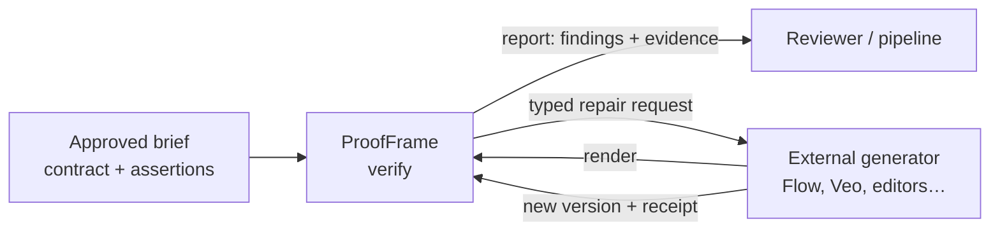

# ProofFrame

**An independent verification layer for generative video pipelines.**
ProofFrame checks a rendered video against the brief that was approved *before* it was generated, and reports what
it can prove: each finding is tied to real frames and timestamps, failures block release, and anything it cannot
verify stays visibly unresolved. It is built on Meta's Muse Spark multimodal models.

> **Status: working prototype, under active development.** The end-to-end loop runs on real footage with real
> Meta API calls (see [evidence](#what-works-today-measured)). Detection quality has **not** been benchmarked;
> nothing here is production-qualified yet. See [limitations](#limitations).

---

## Why

AI video tools now produce minutes of footage per prompt, and they fail in ways that are easy to miss:
a prop changes color between shots, the approved caption gets one word wrong, a hand appears with no body,
a bottle is both shattered and intact in the same shot. Today a human scrubs through every render, and a
"looks fine" from a second model is not evidence.

ProofFrame sits **between the approved brief and the generator**:



It never generates, never publishes, and can never edit the approved requirements.

## What works today (measured)

All numbers below come from live runs recorded in [`docs/BUILD_STATUS.md`](docs/BUILD_STATUS.md). Costs are
`usage × list price` estimates.

| Capability | Live evidence |
|---|---|
| Exact on-screen text check (Vietnamese, NFC-normalised) | Caught a one-word caption error ("Celina" vs approved "Celia") on 3/3 frames at 13.2–21.6 s; same verdict reproduced on a second run of the same bytes |
| Wardrobe / prop / title-card checks with timestamped evidence | 60 s clip: 4 PASS + 1 FAIL + 1 UNCERTAIN (eye color not readable) for **$0.037** |
| Undeclared-defect scan (`generation_artifact_scan`) | On an AI-generated short: confirmed a bottle that is both shattered and intact in one shot (48–50 s); surfaced an ownerless-hands insert for review. On real live-action footage (*Tears of Steel*): no false FAIL — one candidate rejected (evaluator 0.5); with the stricter ownership rule (0.6) a robot-arm close-up became a REVIEW item |
| Event semantics | "Bottle breaks" initially FAILed because sampled frames missed a 1 s event; fixed (`temporal: occurs`), now PASS with evidence on the correct 0.5 s interval |
| Repair loop | Correct repair → **FIXED**; faulty repair → **STILL_FAILING**; repair that dropped audio → **REGRESSION**; 3rd attempt refused (cap = 2); stale receipt rejected |
| Long video | 2-minute clip, timestamps in minute 2 mapped correctly (**$0.076**). 5-minute files: upload, seek and full pipeline verified without paid calls; est. ≈ $0.35 for 4 whole-video checks |
| Evidence UI | Clicking a finding seeks the player into the evidence interval (Playwright, Firefox + WebKit) |

Test suite: **104 tests** (seed contract/policy, API + Postgres + job leases + atomic budget, pipeline plumbing,
Meta adapter failure semantics, artifact-scan rules). These test our logic, **not** video-understanding accuracy.

## How it works

1. **Approved contract.** Each assertion names a target asset, an approved `expected` value, an optional time
   `scope`, and a *neutral* observation spec (subject + attribute, closed vocabulary where possible).
   Contracts are immutable and hash-identified; new renders never rewrite them.
2. **Coverage ledger first.** Every assertion gets a row before any model runs, so a skipped check is visible as
   `NOT_CHECKED`, never silently missing.
3. **Blind observation.** The model is asked *what it sees*, never told the expected value or a producer's
   "fixed" claim (enforced by a test). Long videos are split into ~60 s windows (the last may reach 70 s) with 3 s overlap.
4. **Server-side evidence.** Model timestamps are only hints: ProofFrame extracts the actual frames with FFmpeg,
   hashes them, and asks a second, independent question on those frames.
5. **Deterministic comparison** in code (exact text after Unicode NFC, closed categories), not by the model.
6. **Undeclared defects.** A three-stage artifact scan (video hunt, independent frame grid, skeptical
   adjudication on higher-resolution frames) looks for anatomy, ownership, object, text, physics and
   within-shot continuity defects nobody wrote an assertion for.
7. **Policy.** `PASS / FAIL / UNCERTAIN / NOT_CHECKED / ERROR / NOT_APPLICABLE` → `BLOCK / REVIEW / ELIGIBLE`.
   A provider error is `ERROR`, never a content `FAIL`; missing coverage is never `PASS`; `ELIGIBLE` is not a
   publishing authorization.
8. **Source-aware repair.** A failure becomes a typed request (stage, field, approved value, preserved checks,
   retest scope, input hash). An external executor returns a new immutable version plus a receipt; ProofFrame
   re-verifies the new bytes and classifies each check as FIXED / STILL_FAILING / REGRESSION / UNCERTAIN.

### Meta models

| Model | Use | Status |
|---|---|---|
| `muse-spark-1.3` (Responses API, Files API, `input_video` with `fps`, `input_image`, strict JSON schema) | Video localization, frame confirmation, artifact scan, adjudication | In the pipeline |
| `sam-3.1` | Object tracking (box/mask grammar parsed) | Probed only ([probes](docs/CAPABILITY_PROBES.md)) |
| `muse-voice-transcribe-1.0` | Vietnamese ASR, turn-level timestamps | Probed only |

Measured ([probes](docs/CAPABILITY_PROBES.md)): ≈ 117 input tokens per second of video at 1 fps / 640 px; ≈ 530 input tokens per 960 px confirmation frame (3-frame calls ≈ 1.6k tokens incl. prompt).

## Quickstart

Requirements: Docker with Compose v2. No GPU.

```bash
git clone https://github.com/nhocconan/proofframe.git && cd proofframe
cp .env.example .env            # set META_DEV_API=<your Meta developer API key>
                                # PROOFFRAME_API_TOKEN is optional locally (falls back to a dev token); required for any public deployment
mkdir -p dropbox media && setfacl -m u:10001:rwx -m d:u:10001:rwx dropbox   # Linux; containers run as uid 10001
docker compose up -d --build db api worker web
# browse to http://127.0.0.1:3000 (UI); API on 127.0.0.1:8080
```

Spend caps live in `docker-compose.yml` (`PROOFFRAME_MAX_PROJECT_COST_USD`, `PROOFFRAME_MAX_RUN_COST_USD`);
paid calls reserve a conservative amount *before* each request, and a refused reservation makes the check
`NOT_CHECKED`.

Verify a video from the CLI (same service the UI uses):

```bash
cp my_video.mp4 media/ && cp demo/contract_template_own_video.json dropbox/my_contract.json  # edit it first
docker compose exec -e PROOFFRAME_API_URL=http://localhost:8080 api \
  proofframe verify --contract /dropbox/my_contract.json --video my-video=/media/my_video.mp4 --wait
```

Writing contracts, the repair round trip, tests and the Traefik deployment are covered in
[`docs/RUNBOOK.md`](docs/RUNBOOK.md).

## Limitations

- **No accuracy benchmark yet.** Two clips, a handful of assertions. Precision/recall, defect-escape rate and
  comparison with a human or another model are unmeasured.
- **Most recorded live runs predate the latest evaluator changes** (versions are stamped in every report); later
  changes were verified with unit tests and the specific live reruns listed in BUILD_STATUS.
- **Sampled, not exhaustive.** 1–2 fps video passes plus a few frames per check; events shorter than the sampling
  interval can be missed. Every report says so.
- **One model family.** Localization, confirmation and adjudication all use `muse-spark-1.3`; agreement between
  them is not independent proof. Hand-ownership judgments contradicted each other in testing, so they are always
  routed to human review.
- **Not yet in the pipeline:** SAM tracking, speech/dialogue checks, lip sync, story-time vs edit-time,
  cross-shot dependency graphs, result caching.
- **Repairs:** only a deterministic FFmpeg caption-composite executor exists; generative shot regeneration is a
  typed action without an executor.
- Single tenant, static API token; the API must stay on a private network.

## Roadmap

1. Frozen development + held-out sets of real productions with human labels; report precision/recall per defect class.
2. SAM 3.1 tracks for prop/occlusion questions; Muse Voice for dialogue-vs-script and caption alignment.
3. Cross-shot continuity (expected story state, approved transitions) and assembled-timeline checks.
4. Generative repair executors behind the same receipt protocol; integration with existing content pipelines.

## Repository layout

```
src/proofframe_contracts/   typed contract, report and repair records + fail-closed policy (domain, no SDKs)
src/proofframe/verify/      pipeline, deterministic comparison, artifact scan
src/proofframe/providers/   Meta adapter (budget-reserved, failure-classified calls)
src/proofframe/api, worker  FastAPI service, Postgres job queue with leases
src/proofframe/repair/      repair request/receipt protocol, file-drop executor
web/                        Next.js evidence workbench
demo/                       demo contracts (Tears of Steel) and a template for your own video
docs/                       build status, runbook, API contract, capability probes, design docs, original handoff
validation/                 live run reports and UI screenshots used as evidence
```

## Credits

Demo footage: *Tears of Steel* © Blender Foundation | mango.blender.org, CC-BY 3.0 (not stored in this
repository). See [`NOTICE.md`](NOTICE.md). License for this repository: not yet chosen.
