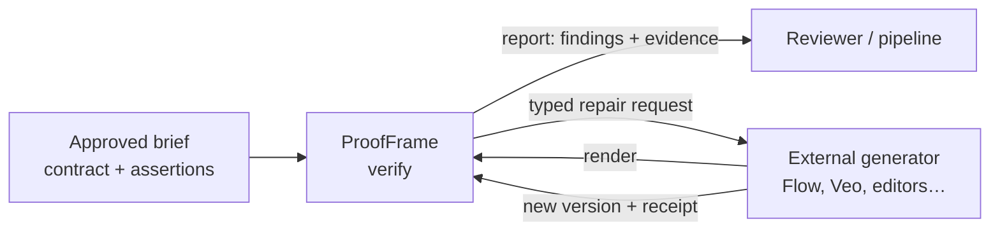

# ProofFrame

**An independent verification layer for generative video pipelines.**
ProofFrame checks a rendered video against the brief that was approved *before* it was generated, and reports what
it can prove: each finding is tied to real frames and timestamps, failures block release, and anything it cannot
verify stays visibly unresolved. It is built on Meta's Muse Spark multimodal models.

> **Status: working prototype, under active development.** The end-to-end loop runs on real footage with real
> Meta API calls (see [evidence](#what-works-today-measured)). Detection quality has **not** been benchmarked;
> nothing here is production-qualified yet. See [limitations](#limitations).

---

## Why

AI video tools now produce minutes of footage per prompt, and they fail in ways that are easy to miss:
a prop changes color between shots, the approved caption gets one word wrong, a hand appears with no body,
a bottle is both shattered and intact in the same shot. Today a human scrubs through every render, and a
"looks fine" from a second model is not evidence.

ProofFrame sits **between the approved brief and the generator**:



It never generates, never publishes, and can never edit the approved requirements.

## What works today (measured)

All numbers below come from live runs recorded in [`docs/BUILD_STATUS.md`](docs/BUILD_STATUS.md). Costs are
`usage × list price` estimates.

| Capability | Live evidence |
|---|---|
| Exact on-screen text check (Vietnamese, NFC-normalised) | Caught a one-word caption error ("Celina" vs approved "Celia") on 3/3 frames at 13.2–21.6 s; same verdict reproduced on a second run of the same bytes |
| Wardrobe / prop / title-card checks with timestamped evidence | 60 s clip: 4 PASS + 1 FAIL + 1 UNCERTAIN (eye color not readable) for **$0.037** |
| Undeclared-defect scan (`generation_artifact_scan`) | On an AI-generated short: confirmed a bottle that is both shattered and intact in one shot (48–50 s); surfaced an ownerless-hands insert for review. On real live-action footage (*Tears of Steel*): no false FAIL — one candidate rejected (evaluator 0.5); with the stricter ownership rule (0.6) a robot-arm close-up became a REVIEW item |
| Event semantics | "Bottle breaks" initially FAILed because sampled frames missed a 1 s event; fixed (`temporal: occurs`), now PASS with evidence on the correct 0.5 s interval |
| Repair loop | Correct repair → **FIXED**; faulty repair → **STILL_FAILING**; repair that dropped audio → **REGRESSION**; 3rd attempt refused (cap = 2); stale receipt rejected |
| Cross-shot continuity audit | On a 60 s AI-generated short (13 shots): caught a boombox shrinking to hand size between scenes, its design changing, and a watch appearing/disappearing between consecutive shots; **4–5 of 8** labelled must-catch defects surfaced per full run (incl. the artifact scan), **0** false FAIL on real live-action footage — see [evaluation](#evaluation) |
| Long video | 2-minute clip, timestamps in minute 2 mapped correctly (**$0.076**). 5-minute files: upload, seek and full pipeline verified without paid calls. A pre-run cost plan shrinks the audits to the remaining budget (5-min film, full contract: est. $2.06 → fits $2 by halving long-range pairs; not yet run live) |
| Budget stop | Owner clip with the run cap lowered to $0.30: spent $0.259; both audits UNCERTAIN ("18 of 27 calls not made") instead of being discarded, never PASS. Keeping a confirmed FAIL through a budget stop is covered by tests only |
| Evidence UI | Clicking a finding seeks the player into the evidence interval (Playwright, Firefox + WebKit) |

Test suite: **123 tests** (CI runs them on every push: `.github/workflows/ci.yml`) (seed contract/policy, API + Postgres + job leases + atomic budget, pipeline plumbing,
Meta adapter failure semantics, artifact-scan and continuity-audit rules). These test our logic, **not** video-understanding accuracy.

## How it works

1. **Approved contract.** Each assertion names a target asset, an approved `expected` value, an optional time
   `scope`, and a *neutral* observation spec (subject + attribute, closed vocabulary where possible).
   Contracts are immutable and hash-identified; new renders never rewrite them.
2. **Coverage ledger first.** Every assertion gets a row before any model runs, so a skipped check is visible as
   `NOT_CHECKED`, never silently missing.
3. **Blind observation.** The model is asked *what it sees*, never told the expected value or a producer's
   "fixed" claim (enforced by a test). Long videos are split into ~60 s windows (the last may reach 70 s) with 3 s overlap.
4. **Server-side evidence.** Model timestamps are only hints: ProofFrame extracts the actual frames with FFmpeg,
   hashes them, and asks a second, independent question on those frames.
5. **Deterministic comparison** in code (exact text after Unicode NFC, closed categories), not by the model.
6. **Undeclared defects.** A three-stage artifact scan (video hunt, independent frame grid, skeptical
   adjudication on higher-resolution frames) looks for anatomy, ownership, object, text, physics and
   within-shot continuity defects nobody wrote an assertion for.
7. **Cross-shot continuity.** Per-shot scans cannot see errors that only exist *between* shots. ProofFrame
   splits the film into shots (FFmpeg scene score), builds a blind continuity log of recurring characters,
   props and sets, compares every adjacent pair, pairs bridging short insert shots, and first-vs-later
   appearances of each logged entity (intrinsic size/design/material only), then re-checks each suspicion
   with the two shots in **swapped order** on higher-resolution frames. Face-identity drift is always routed to
   human review.
8. **Policy.** `PASS / FAIL / UNCERTAIN / NOT_CHECKED / ERROR / NOT_APPLICABLE` → `BLOCK / REVIEW / ELIGIBLE`.
   A provider error is `ERROR`, never a content `FAIL`; missing coverage is never `PASS`; `ELIGIBLE` is not a
   publishing authorization.
9. **Source-aware repair.** A failure becomes a typed request (stage, field, approved value, preserved checks,
   retest scope, input hash). An external executor returns a new immutable version plus a receipt; ProofFrame
   re-verifies the new bytes and classifies each check as FIXED / STILL_FAILING / REGRESSION / UNCERTAIN.

### Meta models

| Model | Use | Status |
|---|---|---|
| `muse-spark-1.3` (Responses API, Files API, `input_video` with `fps`, `input_image`, strict JSON schema) | Video localization, frame confirmation, artifact scan, adjudication | In the pipeline |
| `sam-3.1` | Object tracking (box/mask grammar parsed) | Probed only ([probes](docs/CAPABILITY_PROBES.md)) |
| `muse-voice-transcribe-1.0` | Vietnamese ASR, turn-level timestamps | Probed only |

Measured ([probes](docs/CAPABILITY_PROBES.md)): ≈ 117 input tokens per second of video at 1 fps / 640 px; ≈ 530 input tokens per 960 px confirmation frame (3-frame calls ≈ 1.6k tokens incl. prompt).

## Quickstart

Requirements: Docker with Compose v2. No GPU.

```bash
git clone https://github.com/nhocconan/proofframe.git && cd proofframe
cp .env.example .env            # set META_DEV_API=<your Meta developer API key>
                                # PROOFFRAME_API_TOKEN is optional locally (falls back to a dev token); required for any public deployment
mkdir -p dropbox media && setfacl -m u:10001:rwx -m d:u:10001:rwx dropbox   # Linux; containers run as uid 10001
docker compose up -d --build db api worker web
# browse to http://127.0.0.1:3000 (UI); API on 127.0.0.1:8080
```

Spend caps live in `docker-compose.yml` (`PROOFFRAME_MAX_PROJECT_COST_USD`, `PROOFFRAME_MAX_RUN_COST_USD`);
paid calls reserve a conservative amount *before* each request. Before the first call the run is planned to fit
the remaining budget (reductions are listed on the run page). If the budget still runs out, results already paid
for are kept and the affected check can no longer PASS (`UNCERTAIN`, or `NOT_CHECKED` if nothing ran).

Verify a video from the CLI (same service the UI uses):

```bash
cp my_video.mp4 media/ && cp demo/contract_template_own_video.json dropbox/my_contract.json  # edit it first
docker compose exec -e PROOFFRAME_API_URL=http://localhost:8080 api \
  proofframe verify --contract /dropbox/my_contract.json --video my-video=/media/my_video.mp4 --wait
```

Writing contracts, the repair round trip, tests and the Traefik deployment are covered in
[`docs/RUNBOOK.md`](docs/RUNBOOK.md).

## Evaluation

The shared core now supports decoded black/freeze/silence measurements with source-time evidence and zero model calls for technical-only runs. Offline scoring separates confirmed findings from review items, uses one-to-one event matching, respects human adjudication and supports recorded judge controls. See the [runbook](docs/RUNBOOK.md#decoded-technical-qc) for the runnable contract and commands. These additions do not establish perception accuracy or SOTA status; the development results below predate them.

Audio delivery checks now measure integrated loudness/true peaks, including audio-only assets via `--audio`. Fractional tolerances, directional limits and printed-meter resolution are explicit. A [frozen-cohort comparison command](docs/RUNBOOK.md#frozen-cohort-baseline-comparison) binds baseline results to identical media/contracts and rejects cross-split leakage. The [industrial research decisions](docs/RESEARCH_AND_DECISIONS.md#6-industrial-implementation-decisions-2026-10-29) distinguish implemented measurements from deferred specialist capabilities.

A small **development** evaluation, not a benchmark. Labels: 11 defects (8 must-catch) on a 60 s AI-generated
short, written by a reviewer from 2 fps contact sheets *before* the continuity audit was built, not yet
confirmed by the film's owner. The same clip was used to improve the method, so these numbers are optimistic;
there is no held-out set yet. Scorer: [`scripts/score_findings.py`](scripts/score_findings.py) (time overlap +
category + entity keyword; unmatched findings are listed for a human, not silently counted).

| Version (evaluator) | Must-catch surfaced (of 8) | False FAIL on live-action control | Notes |
|---|---|---|---|
| per-shot artifact scan only (0.7) | 2 | 0 | bottle shattered-and-intact; ownerless-hands insert as review |
| + continuity log only (0.8) | 2 | 0 | log tracked entities well but listed almost no contradictions |
| + adjacent/registry pairs, swapped-order adjudication (0.9–0.10) | 3 → 5 | 1 → 0 | a hologram "size change" was a false FAIL until VFX was added as an innocent explanation |
| + adjudicate up to 24 suspicions, concurrent checks (0.11–0.12) | **5 and 4** (two full-contract runs) | 0 (2 runs) | two continuity-only runs caught 3 and 4 cross-shot defects; the artifact scan caught D4 and surfaced D1 in each of its last 6 runs; candidate generation varies run-to-run |

Per minute of footage (measured on the 60 s clip, full contract incl. both audits): ≈ **$0.64–0.74**
estimated, **146 s** wall time after concurrency (was 287 s). Consistently missed: furniture swap between
shots (caught 1/4 runs), a person vanishing across an insert (raised by the pair stage, rejected at
adjudication), a bag changing material. Also reported but not in the labels (owner to judge): a telephone
appearing on a table, a bottle growing when it falls, a handle changing color.

## Prior art and credits

All ProofFrame code in this repository was written for this project; **no third-party source code was
copied**. Runtime dependencies are listed in `requirements.lock` and `web/package-lock.json`; FFmpeg is used as
an external binary. Ideas we adopted, with credit:

- Blind observation before comparison, separate scoring — *continuity-checker* (J. Muller, MIT), see
  [`docs/SOURCE_REGISTER.md`](docs/SOURCE_REGISTER.md) S01.
- Entity registry / memory of first appearances for cross-shot consistency — *EntityBench* (arXiv 2605.15199),
  *VideoMemory* (arXiv 2601.03655), *GroundShot* (arXiv 2606.20799).
- Rubric-style judging of adjacent shot pairs rather than one global score — *MSAVBench* (arXiv 2605.20183).
- Order swapping because VLM judges show position bias — arXiv 2406.07791 and 2607.25300.
- Shot detection by scene-change score — FFmpeg `select='gt(scene,…)'`; *PySceneDetect* / *TransNetV2*
  evaluated as alternatives, not used.

The full review with URLs and verification status is in
[`docs/SOTA_CONTINUITY_REVIEW.md`](docs/SOTA_CONTINUITY_REVIEW.md). We found **no independent accuracy
measurement of any commercial continuity checker**, so we make no comparative claim.

## Limitations

- **No accuracy benchmark yet.** Two clips, a handful of assertions. Precision/recall, defect-escape rate and
  comparison with a human or another model are unmeasured.
- **Most recorded live runs predate the latest evaluator changes** (versions are stamped in every report); later
  changes were verified with unit tests and the specific live reruns listed in BUILD_STATUS.
- **Sampled, not exhaustive.** 1–2 fps video passes plus a few frames per check; events shorter than the sampling
  interval can be missed. Every report says so.
- **One model family.** Localization, confirmation and adjudication all use `muse-spark-1.3`; agreement between
  them is not independent proof. Hand-ownership judgments contradicted each other in testing, so they are always
  routed to human review.
- **Run-to-run variance.** The same video surfaced 4 or 5 of 8 labelled defects on different full runs; a
  single clean run is not proof of a clean film.
- **Continuity is keyframe-based.** Two keyframes per shot; changes inside a shot between keyframes, dissolves
  and contradictions between distant batches of a long film can be missed.
- **Not yet in the pipeline:** SAM tracking (would allow measured size ratios instead of judged ones),
  embedding similarity as a cheap pre-filter, speech/dialogue checks, lip sync, story-time vs edit-time, caching.
- **Repairs:** only a deterministic FFmpeg caption-composite executor exists; generative shot regeneration is a
  typed action without an executor.
- Single tenant, static API token; the API must stay on a private network.

## Roadmap

1. Owner-confirmed labels plus a held-out set of other productions; report precision/recall per defect class.
2. SAM 3.1 tracks for prop/occlusion questions; Muse Voice for dialogue-vs-script and caption alignment.
3. Cross-shot continuity (expected story state, approved transitions) and assembled-timeline checks.
4. Generative repair executors behind the same receipt protocol; integration with existing content pipelines.

## Repository layout

```
src/proofframe_contracts/   typed contract, report and repair records + fail-closed policy (domain, no SDKs)
src/proofframe/verify/      pipeline, deterministic comparison, artifact scan, cross-shot continuity audit
src/proofframe/providers/   Meta adapter (budget-reserved, failure-classified calls)
src/proofframe/api, worker  FastAPI service, Postgres job queue with leases
src/proofframe/repair/      repair request/receipt protocol, file-drop executor
web/                        Next.js evidence workbench
demo/                       demo contracts (Tears of Steel) and a template for your own video
docs/                       build status, runbook, API contract, capability probes, design docs, original handoff
validation/                 live run reports and UI screenshots used as evidence
```

## Credits

Demo footage: *Tears of Steel* © Blender Foundation | mango.blender.org, CC-BY 3.0 (not stored in this
repository). See [`NOTICE.md`](NOTICE.md). License for this repository: not yet chosen.
